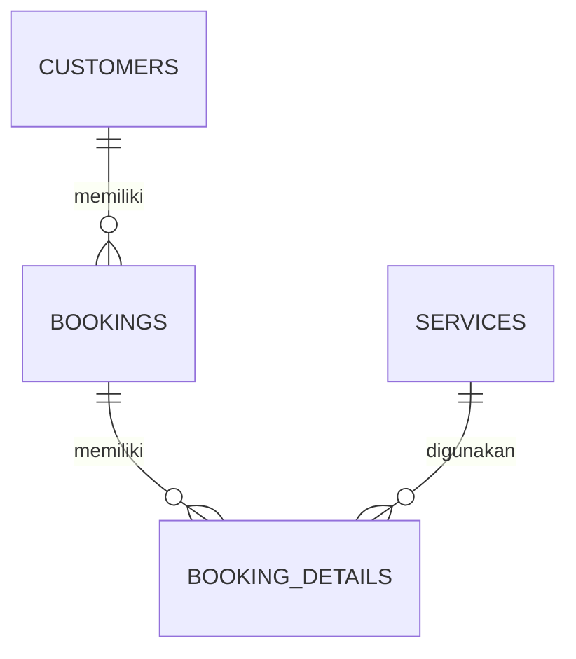

# ENTITY RELATIONSHIP DIAGRAM (ERD)
## Sistem Pemesanan Servis Bintang Service

### 1. Daftar Entitas

**CUSTOMERS**
- id (Primary Key)
- name
- phone
- created_at

**BOOKINGS**
- id (Primary Key)
- customer_id (Foreign Key)
- booking_date
- booking_time
- motorcycle_type
- motorcycle_number
- status
- created_at

**BOOKING_DETAILS**
- id (Primary Key)
- booking_id (Foreign Key)
- service_id (Foreign Key)
- quantity
- price

**SERVICES**
- id (Primary Key)
- code
- service_name
- category
- description
- price
- created_at

### 2. Hubungan Antarentitas

1. CUSTOMERS ke BOOKINGS: satu pelanggan dapat memiliki banyak pemesanan.
2. BOOKINGS ke BOOKING_DETAILS: satu pemesanan dapat memiliki beberapa detail layanan.
3. SERVICES ke BOOKING_DETAILS: satu layanan dapat digunakan pada banyak detail pemesanan.

### 3. Diagram Relasi

### 4. Keterangan

PK = Primary Key (kunci utama).

FK = Foreign Key (kunci penghubung).

Relasi diagram disusun berdasarkan struktur tabel dan foreign key yang diperiksa melalui HeidiSQL.